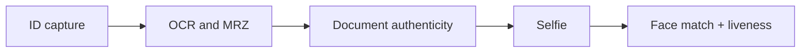
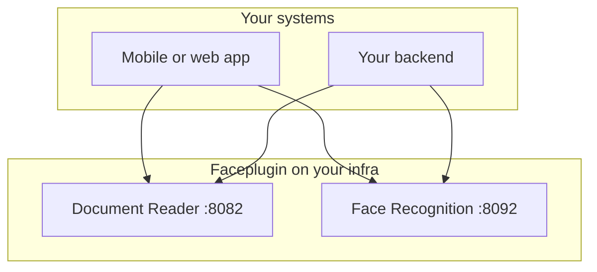

# Architecture

Faceplugin ships product SDKs you combine in **your** mobile app or backend.

Faceplugin does **not** ship one all-in-one identity-verification app.

### One product per service

Face recognition and face liveness are **separate server products**. For face work on a server, run both and call them from your backend:

| Need                                 | Run                                                                                                                                                    | Notes                                                                           |
| ------------------------------------ | ------------------------------------------------------------------------------------------------------------------------------------------------------ | ------------------------------------------------------------------------------- |
| Face match + face PAD                | [Face Recognition](../../products/face-recognition-sdk/recognition/server-sdk/) on **8092** (`faceplugin/face-recognition`) **and** [Face Liveness](../../products/face-recognition-sdk/liveness-detection-sdk/server-sdk/) on **8093** | Two processes, each with its own runtime folder                                 |
| Face match + face PAD on a phone     | [Face Recognition + Liveness Mobile](../../products/face-recognition-sdk/recognition-and-liveness/mobile-sdk/)                                         | One SDK, both on the device, no server at all                                   |
| Document OCR + document authenticity | [Document Reader](../../products/id-document-recognition-sdk/recognition-and-liveness/) on **8082** with a Liveness-capable license                     | One product covers both                                                         |

Use standalone [Face Liveness](../../products/face-recognition-sdk/liveness-detection-sdk/) (**8093**) or [ID Document Liveness](../../products/id-document-recognition-sdk/id-document-liveness-sdk/) (**8086**) when you want **anti-spoofing without** matching or OCR.

### Typical eKYC flow

**eKYC** means electronic know-your-customer / digital identity onboarding.



| Step                                           | Recommended product                                                                                                        |
| ---------------------------------------------- | -------------------------------------------------------------------------------------------------------------------------- |
| Read the ID + check it is real                 | [ID Document Recognition + Liveness](../../products/id-document-recognition-sdk/recognition-and-liveness/) (port **8082**) |
| Check the selfie is live and match to ID photo | [Face Recognition + Liveness](../../products/face-recognition-sdk/recognition-and-liveness/) (port **8092**)               |

You own the final pass / fail decision. The SDKs return scores and fields. They do not decide your business outcome.

### Recommended topology

Run **one process or container per product**. For face and documents, that product should usually be the **combined** package.



Optional authenticity-only Document Liveness (**8086**) or Face Liveness (**8093**) only if you intentionally split services.

### One runtime per server

Each product is its **own** process or container. Each has its own `lib/cpu/` (or Hub image that already includes the runtime).

You do **not** install Document and Face into one App tree. To use both, run **two servers** (for example Document on **8082** and Face Recognition on **8092**) and call both from your backend.

```
document-reader/          face-recognition/
  lib/cpu/   ← Document     lib/cpu/   ← Face only
  app.py                    app.py
```


Do **not** dump a second product’s runtime into another product’s `lib/cpu/`. OpenCV, OpenSSL, and ONNX builds differ; files overwrite each other and the process can crash or return wrong scores. Keep one release runtime per App / container.


On mobile, **Recognition + Liveness** is one SDK that does both on the device. On a server there is no combined package: run Face Recognition and Face Liveness as two services, each with its own runtime folder.

### Who owns what

| You own                              | Faceplugin SDK owns                                |
| ------------------------------------ | -------------------------------------------------- |
| Template / person gallery database   | Face detect, quality, template extract, 1:1 match  |
| Document JSON storage and PII policy | OCR, MRZ, barcode, document authenticity scores    |
| Orchestration and business decisions | Face liveness / PAD score                          |
| TLS, reverse proxy, network access   | Engine processing inside your process or container |
| License request and key storage      | Offline activate after you install the key         |

A **template** is a face feature vector. Store it in **your** database. The server Face Recognition API has **no** `POST /api/identify` gallery.

### Two ways to integrate on a server

#### Option A — HTTP sidecar

Run `app.py` or the Docker image. Call it from any language.

```
Your backend  →  HTTP API  →  sdk.py  →  lib/cpu
```

Use this when several services need the engine, or when your backend is not Python.

#### Option B — In-process Python

Import `sdk.py` on the **same** host as `lib/cpu/` (or inside the container).

```
Your Python process  →  sdk.py  →  lib/cpu
```

Use this when you want fewer network hops and you already run Python next to the runtime.

**Gradio** (`demo` / `demo.py`) is a local UI for testing. Do not ship it in production. See [Production deployment](production-deployment.md).

### Mobile multi-SDK note

On mobile, keep each product’s AAR or frameworks separate. Request one license **per** application id **per** product. Call one engine at a time.

Face Liveness has no public Flutter or React Native SDK. Prefer Face Recognition + Liveness mobile apps (Identify includes 2D liveness), and/or a native Face Liveness module when you need PAD without matching.

### Related documentation

* [Hosting requirements](hosting-requirements.md) · [Production deployment](production-deployment.md) · [HTTP API](../http-api/) · [Choose a product](../../getting-started/choose-a-product.md)
