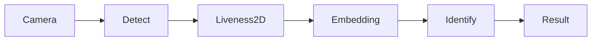

# Capabilities

What the Faceplugin **Face SDK** can do — **recognition**, **liveness**, and **recognition + liveness** — before you pick a platform.

| Mode                       | What you get                                            | Start install                                       |
| -------------------------- | ------------------------------------------------------- | --------------------------------------------------- |
| **Recognition**            | Detect, quality, templates, 1:1 verification, 1:N identification | [Recognition](recognition/)                |
| **Liveness**               | Standalone face anti-spoofing, no gallery — passive and active on mobile, passive on the server | [Liveness](liveness-detection-sdk/)                 |
| **Recognition + Liveness** | Recognition and passive 2D liveness in one mobile SDK | [Recognition + Liveness](recognition-and-liveness/) |

### Face Recognition: 1:1 Matching and 1:N Identification

After you activate with a license key, face detection, template extraction, and matching run **offline** on the device or on **your** Windows/Linux host. Images are not sent to a Faceplugin cloud.

The algorithm is evaluated on **NIST FRVT** (as stated across Faceplugin Face Recognition docs).

| Mode             | Where             | How                                                                                                 |
| ---------------- | ----------------- | --------------------------------------------------------------------------------------------------- |
| **1:1**          | Mobile and server | Extract two templates → `similarity` / `POST /api/similarity`, or `POST /api/match` with two images |
| **1:N Identify** | Mobile and server | Mobile: VideoWorker over the templates you store. Server: `POST /api/v1/identify` over the local gallery (demo default match threshold **0.67**) |

On **Windows / Docker**, the HTTP API covers still-image **detect / quality / feature / match / similarity**, plus a local gallery with **`POST /api/v1/identify`** and `/api/v1/persons`. You can still store templates yourself and call similarity instead.

`templateExtraction` / `POST /api/feature` generates face templates that you can store in **your own database**. Faceplugin does not host your users' face data or provide a cloud-based person gallery.

Mobile **1:N Identify** includes passive 2D liveness (default threshold **0.5**) as part of the identify flow. That is **not** the same as the standalone Liveness product below.

#### Face Recognition REST API (Port 8092)

| Route                  | Role          |
| ---------------------- | ------------- |
| `GET /api/machinecode` | Machine code  |
| `POST /api/activate`   | Activate      |
| `POST /api/detect`     | Detect faces  |
| `POST /api/quality`    | Quality       |
| `POST /api/feature`    | Template      |
| `POST /api/match`      | Two images    |
| `POST /api/similarity` | Two templates |
| `POST /api/identify`   | 1:N gallery search |
| `/api/persons`         | Enroll and manage people |

Routes also answer under `/api/v1`. Image: `faceplugin/face-recognition` (tags `latest` for **Lite** and `latest-plus` for **Plus**). See [Docker](recognition/server-sdk/face-recognition-linux-sdk.md) · [Windows](recognition/server-sdk/face-recognition-windows-sdk.md).

### Face Liveness Detection: Passive and Active Anti-Spoofing (PAD)

Standalone presentation-attack detection in two modes:

* **Passive** — the engine scores a single camera frame or JPEG **without** asking the user to do anything. Available on mobile and on the server.
* **Active** — mobile only. The face is scored for spoofing first, as an anti-spoofing gate; only a face that clears the gate is asked for a short shuffled sequence of challenges (blink, smile, turn left/right, look up/down, move closer). The result object reports the gate score and every challenge outcome.

The server SDKs (Windows, Linux/Docker) are **passive only** — there is no active liveness over HTTP.

In internal testing following **ISO/IEC 30107-3** at the default threshold, **no genuine presentation was rejected on either platform** — **BPCER 0%** on the phone and on the server. Attacks accepted (**APCER**) were **3.5–5.5%** on the phone and **0.5–1.5%** on the server, across printed photos, screen replays (photo and video) and 3D masks: the phone scores live camera frames, while the server scores a finished image. Both rates move with the threshold. This is an internal FacePlugin QA evaluation; these docs do **not** claim iBeta certification. See [Liveness](liveness-detection-sdk/) for the trade-off and how to choose a threshold.

Detects attack types including:

* Printed photos
* Screen replays
* 3D models / masks
* Deepfake-style video (one type of spoof — not a separate deepfake product)

Score **≥ 0.5** → Real / pass (server default threshold in these docs).

| Surface             | Behavior                                                      |
| ------------------- | ------------------------------------------------------------- |
| **Mobile** (Android, iOS, Flutter, React Native, Ionic Capacitor, Ionic Cordova, .NET MAUI) | Live camera anti-spoofing, passive or active (gate + challenges) |
| **Linux / Windows** | `POST /api/liveness` with one RGB JPEG on port **8093**, passive only |

**Example: check liveness with curl**

<pre class="language-bash"><code class="lang-bash"><strong>curl -s -X POST http://127.0.0.1:8093/api/liveness \
</strong>  -H 'Content-Type: application/json' \
  -d "{\"image\":\"$IMG\"}"
</code></pre>

Images: `faceplugin/face-liveness`. See [Linux](liveness-detection-sdk/server-sdk/liveness-detection-linux-sdk.md) · [Windows](liveness-detection-sdk/server-sdk/liveness-detection-windows-sdk.md).

#### Which Face SDK Mode Should I Choose?

| Need                                                      | Mode                                                              |
| --------------------------------------------------------- | ----------------------------------------------------------------- |
| Enroll / 1:N match (mobile Identify includes 2D liveness) | **Face Recognition**                                              |
| Anti-spoofing only (no gallery)                           | **Face Liveness**                                                 |
| Recognition + anti-spoofing on one device                 | **Face Recognition + Liveness** (mobile)                          |
| Document authenticity (ID spoof)                          | [ID Document SDK](../id-document-recognition-sdk/capabilities.md) |

### Supported Platforms

| Mode                   | Available as                                                                                                                                                                                                                                                                                                                                                  |
| ---------------------- | ------------------------------------------------------------------------------------------------------------------------------------------------------------------------------------------------------------------------------------------------------------------------------------------------------------------------------------------------------------- |
| Recognition            | [Server SDK](recognition/server-sdk/) (`faceplugin/face-recognition`, Lite and Plus) · [Open Source](recognition/open-source-windows-and-linux/)                                                                                                                                                                                                            |
| Liveness               | [Mobile SDK](liveness-detection-sdk/mobile-sdk/) — Android, iOS, Flutter, React Native, Ionic Capacitor, Ionic Cordova and .NET MAUI (passive **and** active) · [Server SDK](liveness-detection-sdk/server-sdk/) (**8093**, passive only)                                                                                                                                                                                                                                                |
| Recognition + Liveness | [Mobile SDK](recognition-and-liveness/mobile-sdk/) — Android, iOS, Flutter, React Native, .NET MAUI, Ionic Capacitor and Ionic Cordova. Mobile only. |

### Use cases

* **Access control and time attendance:** enroll face templates and run live 1:N identification at doors, gates and terminals.
* **eKYC selfie verification:** run passive anti-spoofing before, or together with, face matching.
* **Server-side fraud checks:** still-image detection, matching, similarity and 1:N identification on port 8092, plus liveness as its own service on port 8093.

### Frequently Asked Questions

**Can Faceplugin face recognition work fully offline?**

Yes. After license activation, face detection and matching run entirely on your device or server with no internet connection.

**Is there a face recognition API?**

Yes. The Face Recognition server exposes an HTTP REST API on port 8092, with endpoints for detection, quality, feature extraction, match and similarity.

**Is there a server-side 1:N face gallery?**

No. Store face templates in your own database and compare them with `/api/similarity`.

**What is the difference between Identify's 2D liveness and the standalone Liveness SDK?**

Identify builds 2D liveness into face matching on mobile. The standalone Liveness SDK does anti-spoofing only — passive or active on mobile, passive on the server at port 8093.

**What liveness score counts as a real face?**

A score of 0.5 or higher is treated as real. This is the default server threshold.

### Related documentation

* [Face SDK](./) · [Try it](../../getting-started/try-it.md) · [Glossary](../../help/resources/glossary.md)
* [ID Document capabilities](../id-document-recognition-sdk/capabilities.md)
* [Request a License](../../help/request-a-license-and-support.md)
