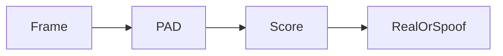

# Liveness

### Overview

**Faceplugin Face Liveness Detection SDK** is an on-premise **face anti-spoofing** / presentation-attack detection (PAD) engine. It answers: is a **live person** in front of the camera, or a printout, phone screen, 3D mask, or deepfake-style video?

**What it can do:** [Face SDK capabilities](../capabilities.md) (Liveness section) — passive anti-spoofing, mobile vs server, and when to use it versus Face Recognition Identify.

This product is **passive** anti-spoofing: no smile / turn-head challenge. Active challenge demos on GitHub are **not** this product, and the optional active prompts on some Face Recognition Identify flows are not this SDK either.

### Evaluation results

Internal PAD evaluation following **ISO/IEC 30107-3**, passive mode at the default threshold of **0.5**, against four presentation attack instrument (PAI) species: printed photo, screen replay (photo), screen replay (video), and a painted 3D resin mask.

| Measure | Phone (on-device SDK) | Server (HTTP API) |
| ------- | --------------------- | ----------------- |
| **BPCER** — a real face rejected | **0%** | **0%** |
| **APCER** — an attack accepted as a real face | **3.5–5.5%** | **0.5–1.5%** |

Read the two rows together. At the default threshold the engine turned away **no genuine presentation** on either platform, and it paid for that on the attack side: roughly 1 attack in 18–29 got through on the phone, and 1 in 67–200 on the server.

**Why the phone lets more through.** The server scores a finished image — chosen, full resolution, deliberately framed. The phone scores whatever the live camera produces, on hardware from an entry-level sensor to a flagship, in office light, daylight and low light. A dim, noisy or motion-blurred frame carries fewer of the cues that separate a print or a replayed screen from a real face. The capture stage, not the model, explains the gap.

**Both rates follow the threshold.** Leave it at 0.5 when a refused genuine user is the expensive outcome. Raise it when an accepted attack is — and expect bona fide rejections to appear as APCER falls. On mobile you can often close the gap instead by raising the capture bar: better framing, a brighter prompt, a retry on a poor frame.


This is an **internal FacePlugin QA evaluation**, not an independent laboratory result. These docs do **not** claim iBeta certification. A 0% BPCER means *no rejection was observed*, not that the rate is zero — for 600 presentations the one-sided 95% upper bound is about 0.5%. Ask Faceplugin for the full PAD evaluation report, or for a run at your own threshold on the devices you plan to ship.


This SDK is **standalone**. It does **not** enroll people or run 1:N. If you already use Face Recognition Identify on mobile, that flow already includes **passive 2D liveness**. Choose this product when you need anti-spoofing **without** face matching.

Capable of detecting:

* **Printed photos**
* **Screen replays**
* **3D models**
* **Deepfakes** (handled as one type of spoof attack — not a separate deepfake product)

**Mobile** apps run a live camera (VideoWorker plus `faceDetection`). **Linux and Windows** expose a Face Liveness **API**: one RGB JPEG over `POST /api/liveness`. Score **0.5 or higher** is Real / pass.

### Platforms

Start with [Face SDK capabilities](../capabilities.md), then **Mobile SDK** or **Server SDK**.

<table data-view="cards"><thead><tr><th></th><th></th><th></th><th data-hidden data-card-target data-type="content-ref"></th></tr></thead><tbody><tr><td></td><td><strong>Capabilities</strong></td><td>Face SDK capabilities — Recognition, Liveness, Recognition + Liveness.</td><td><a href="../capabilities.md">capabilities.md</a></td></tr><tr><td></td><td><strong>Mobile SDK</strong></td><td>Android and iOS. Live camera anti-spoofing.</td><td><a href="mobile-sdk/">mobile-sdk</a></td></tr><tr><td></td><td><strong>Server SDK</strong></td><td>Windows and Linux / Docker. JPEG over HTTP on port 8084.</td><td><a href="server-sdk/">server-sdk</a></td></tr></tbody></table>

### Use cases

* **KYC / onboarding selfies** — confirm a live person before face match (`faceDetection` / `POST /api/liveness`)
* **Banking and fintech** — block photo and screen replay attacks on selfie capture
* **Access control** — reject printouts and phone-screen spoofs at entry
* **Exam proctoring** — score camera frames for presentation attacks without a challenge animation
* **Fraud prevention** — JPEG anti-spoofing on your server (port **8084**)

### Frequently Asked Questions

**What is passive liveness detection?**&#x20;

The engine scores a camera frame or JPEG without a user challenge animation. See [Face SDK capabilities](../capabilities.md).

**What is the difference between this and Face Recognition liveness?**

Face Recognition mobile Identify includes 2D liveness as part of matching. This product is anti-spoofing only.

### Related documentation

* [Face SDK capabilities](../capabilities.md) · [Face SDK](../) · [ID Document SDK](../../id-document-recognition-sdk/)
* [Request a License](../../../help/request-a-license-and-support.md) · [Try it](../../../getting-started/try-it.md) · [FAQ](../../../help/resources/faq.md) · [Glossary](../../../help/resources/glossary.md)
* [Combining products (eKYC)](../../../getting-started/choose-a-product.md) · [SDK comparison](../../../help/comparisons/)
* [Status codes](../../../help/resources/status-codes.md)
