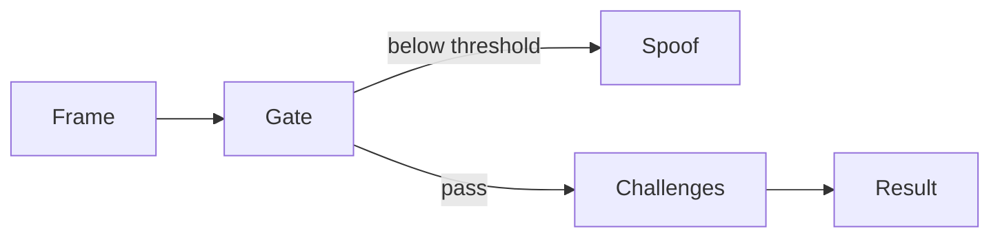

# Mobile

Standalone presentation-attack detection on **Android, iOS, Flutter, React Native, .NET MAUI, Ionic Capacitor and Ionic Cordova**. The demo scores whether the face is **real**. It does not enroll people or run 1:N search.

Every platform wraps the same native engine, so the scores and the challenge behaviour match. The engine binaries come from the [Android](https://github.com/Faceplugin-ltd/FaceRecognition-LivenessDetection-Android/releases/tag/latest) and [iOS](https://github.com/Faceplugin-ltd/FaceRecognition-LivenessDetection-iOS/releases/tag/latest) GitHub releases — `facerecognitionsdk.aar` on Android, four framework bundles on iOS.

### Two ways to check a face

| Mode | What the user does | What you get back |
| ---- | ------------------ | ----------------- |
| **Passive** | Nothing. The engine scores a single frame. | A liveness score, **0.5 or higher** is Real / pass |
| **Active** | Clears an anti-spoofing gate, then a shuffled sequence of actions | `ActiveLivenessResult` — the gate score plus every challenge outcome |

The active flow runs the passive gate **first**. Below the threshold the attempt ends there and **no challenge is asked**: a printed photo or a replayed video is never invited to blink. Losing the face for about a second restarts the whole attempt, gate included, so no attempt can be half-completed by one face and finished by another.

If you already use Face Recognition Identify on mobile, that flow already includes **passive 2D liveness**. Choose this product when you need anti-spoofing **without** enrollment.

For JPEG-over-HTTP on Windows, Linux, and Docker, use [Server SDK](../server-sdk/) — passive only.

### Platforms

<table data-view="cards"><thead><tr><th></th><th></th><th></th><th data-hidden data-card-cover data-type="files"></th><th data-hidden data-card-target data-type="content-ref"></th></tr></thead><tbody><tr><td></td><td><strong>Android SDK</strong></td><td>Native AAR plus the face-liveness-kit and face-liveness-active modules.</td><td><a href="../../../../.gitbook/assets/android.png">android.png</a></td><td><a href="liveness-detection-android-sdk.md">liveness-detection-android-sdk.md</a></td></tr><tr><td></td><td><strong>iOS SDK</strong></td><td>FaceLivenessKit and the engine frameworks. Same flow as Android.</td><td><a href="../../../../.gitbook/assets/apple-logo-3-300x300.png">apple-logo-3-300x300.png</a></td><td><a href="liveness-detection-ios-sdk.md">liveness-detection-ios-sdk.md</a></td></tr><tr><td></td><td><strong>Flutter SDK</strong></td><td>face_liveness_sdk plugin plus an example app.</td><td><a href="../../../../.gitbook/assets/flutter.png">flutter.png</a></td><td><a href="liveness-detection-flutter-sdk.md">liveness-detection-flutter-sdk.md</a></td></tr><tr><td></td><td><strong>React Native SDK</strong></td><td>face-liveness-sdk plugin. Not Expo Go.</td><td><a href="../../../../.gitbook/assets/react.png">react.png</a></td><td><a href="liveness-detection-react-native-sdk.md">liveness-detection-react-native-sdk.md</a></td></tr><tr><td></td><td><strong>.NET MAUI SDK</strong></td><td>One C# codebase for Android and iOS.</td><td><a href="../../../../.gitbook/assets/dotnet.png">dotnet.png</a></td><td><a href="liveness-detection-dot-net-maui-sdk.md">liveness-detection-dot-net-maui-sdk.md</a></td></tr><tr><td></td><td><strong>Ionic Capacitor SDK</strong></td><td>face-liveness-capacitor for new Ionic apps.</td><td><a href="../../../../.gitbook/assets/ionic.png">ionic.png</a></td><td><a href="liveness-detection-ionic-capacitor-sdk.md">liveness-detection-ionic-capacitor-sdk.md</a></td></tr><tr><td></td><td><strong>Ionic Cordova SDK</strong></td><td>Cordova plugin. Prefer Capacitor for new projects.</td><td><a href="../../../../.gitbook/assets/cordova.png">cordova.png</a></td><td><a href="liveness-detection-ionic-cordova-sdk.md">liveness-detection-ionic-cordova-sdk.md</a></td></tr></tbody></table>

### The demo app

Every platform ships the same four-screen demo: **Active liveness**, **Passive liveness**, **Settings** and **About**. Demo ids are the same everywhere — Android `com.faceplugin.faceliveness`, iOS `com.faceplugin.faceliveness.app`.

| Home | Active liveness | Passive liveness | Settings |
| ---- | --------------- | ---------------- | -------- |
|  |  |  |  |

### Shared defaults

Every platform ships the same active-liveness defaults, and the same wire values for challenges and outcomes.

| Setting | Default |
| ------- | ------- |
| Challenges asked | **3**, drawn at random |
| Challenge pool | blink, smile, turn left, turn right, look up, look down (move closer is available but off by default) |
| Liveness threshold (the gate) | **0.5** |
| Passive samples averaged at the gate | **3** |
| Frames allowed per stage | **150** |
| Yaw / pitch for turn and tilt | **25°** / **15°** |
| Smile / blink thresholds | **0.5** / **0.3**, **2** blinks required |
| Move-closer fraction | **0.15** |
| Align angle, minimum face fraction, quality | **12°**, **0.3**, **0.3** |

`ActiveLivenessResult` carries `passed`, `failure` (`NONE`, `SPOOF`, `CHECK`, `TIMEOUT`, `CANCELLED`), `passiveScore`, `passivePassed`, `challenges`, `outcomes` (`PENDING`, `ACTIVE`, `PASSED`, `FAILED`) and `durationMs`.

Status codes: **0** Success, **1** Invalid license, **2** Expired, **3** Not activated, **4** Init failed.

### Frequently Asked Questions

**Is this active or passive liveness detection?**

Both. The SDK scores a frame passively, and also ships a guided active flow that gates on the passive score and then asks for a shuffled sequence of actions.

**What attacks does the mobile liveness SDK detect?**

Printed photos, screen replays, 3D masks and deepfakes.

**What score counts as a real face?**

A liveness score of 0.5 or higher is treated as Real (pass). That is also the default gate threshold for the active flow.

**Can I change which challenges are asked?**

Yes. The pool, how many are drawn, and whether the order is shuffled are all options on the active flow, and the demo exposes them under Settings.

**Does the SDK do face recognition too?**

No. It is anti-spoofing only, with no enrollment or 1:N search. For recognition plus liveness, use the Face Recognition Mobile SDK.

**Does it work offline?**

Yes. Activation and liveness detection run entirely on the device.

### Related documentation

* [Capabilities](../../capabilities.md) · [Faceplugin Face Liveness Detection Server SDK](../server-sdk/) · [Face Liveness Detection SDK](../) · [Glossary](../../../../help/resources/glossary.md)
* [Face Recognition Mobile SDK](../../recognition-and-liveness/mobile-sdk/)
* [Request a License](../../../../help/request-a-license-and-support.md) · [Status codes](../../../../help/resources/status-codes.md)
* [Combining products (eKYC)](../../../../getting-started/choose-a-product.md) · [SDK comparison](../../../../help/comparisons/)
