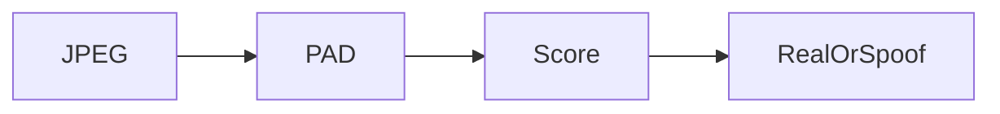

# Server

Score **one RGB JPEG** over HTTP. `POST /api/liveness` (alias `/api/check_liveness`). Score **0.5 or higher** → Real / pass.

Typical call order: `GET /api/machinecode` → send machine code → `POST /api/activate` → `POST /api/liveness`. Default port **8084**.

For a live camera on Android or iOS, use [Mobile SDK](../mobile-sdk/).

Need recognition **and** liveness? Run [Face Recognition Linux](../../recognition/server-sdk/face-recognition-linux-sdk.md) on port **8083** and this product on port **8084**. Do not mix their `lib/cpu` runtimes.

<table data-view="cards"><thead><tr><th></th><th></th><th></th><th data-hidden data-card-cover data-type="files"></th><th data-hidden data-card-target data-type="content-ref"></th></tr></thead><tbody><tr><td></td><td><strong>Linux SDK</strong></td><td>Docker image faceplugin/face-liveness. Same HTTP API as Windows.</td><td><a href="../../../../.gitbook/assets/linux-docker.png">linux-docker.png</a></td><td><a href="liveness-detection-linux-sdk.md">liveness-detection-linux-sdk.md</a></td></tr><tr><td></td><td><strong>Windows SDK</strong></td><td>HTTP API on port 8084. Send a JPEG, get a liveness score. No Docker.</td><td><a href="../../../../.gitbook/assets/windows.png">windows.png</a></td><td><a href="liveness-detection-windows-sdk.md">liveness-detection-windows-sdk.md</a></td></tr></tbody></table>

### Frequently Asked Questions

**What is the Faceplugin face liveness API?**

An HTTP endpoint, `POST /api/liveness`, on port 8084. A score of 0.5 or higher means the face is real (pass).

**What does the liveness API accept?**

One RGB JPEG per request.

**Can I run face recognition and liveness on the same server?**

Yes. Run Face Recognition on port 8083 and Face Liveness on port 8084 as separate services, without mixing their `lib/cpu` runtimes.

**Does the face liveness API check ID documents?**

No. It checks faces only. For ID document anti-spoofing, see the ID Document Liveness SDK.

**Does the liveness server work offline?**

Yes. After license activation, it runs entirely on your own server.

### Related documentation

* [Capabilities](https://github.com/gentlebear0988/temp-docs/tree/main/faceplugin-docs/liveness-detection-sdk/capabilities.md) · [Faceplugin Face Liveness Detection Mobile SDK](../mobile-sdk/) · [Face Liveness Detection SDK](../) · [Glossary](../../../../help/resources/glossary.md)
* [Face Recognition Server SDK](../../recognition/server-sdk/)
* [ID Document Liveness Server SDK](../../../id-document-recognition-sdk/id-document-liveness-sdk/server-sdk/)
* [Request a License](../../../../help/request-a-license-and-support.md) · [Status codes](../../../../help/resources/status-codes.md)
* [Combining products (eKYC)](../../../../getting-started/choose-a-product.md) · [SDK comparison](../../../../help/comparisons/)
