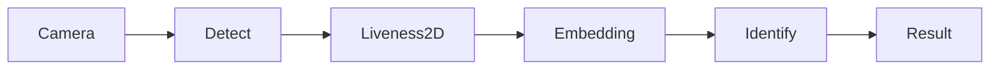

# Mobile

On-device **Face Recognition + Liveness** for Android, iOS, Flutter, React Native, .NET MAUI and Ionic. Enroll people, run live **1:N Identify** with **passive 2D liveness**, and keep the templates in **your** database. Processing stays on the phone.

Every platform wraps the same native engine, so the scores match. The engine binaries come from the [Android](https://github.com/Faceplugin-ltd/FaceRecognition-LivenessDetection-Android/releases/tag/latest) and [iOS](https://github.com/Faceplugin-ltd/FaceRecognition-LivenessDetection-iOS/releases/tag/latest) GitHub releases, and you integrate from the repositories themselves — there is no package-server dependency to add.

Typical call order: `setActivation` → `init` → detect / extract template → `similarity` or VideoWorker (live 1:N). Identify default **0.67**. Liveness default **0.5**.

Every demo app is the same five-tab app: **Identify**, **People**, **Attribute**, **Liveness** and **Settings**.

<table data-view="cards"><thead><tr><th></th><th></th><th></th><th data-hidden data-card-cover data-type="files"></th><th data-hidden data-card-target data-type="content-ref"></th></tr></thead><tbody><tr><td></td><td><strong>Android SDK</strong></td><td>Native AAR plus the face-recognition-kit and capture libraries.</td><td><a href="../../../../.gitbook/assets/android.png">android.png</a></td><td><a href="face-recognition-android-sdk.md">face-recognition-android-sdk.md</a></td></tr><tr><td></td><td><strong>iOS SDK</strong></td><td>FaceRecognitionKit Swift package and the engine xcframework.</td><td><a href="../../../../.gitbook/assets/apple-logo-3-300x300.png">apple-logo-3-300x300.png</a></td><td><a href="face-recognition-ios-sdk.md">face-recognition-ios-sdk.md</a></td></tr><tr><td></td><td><strong>Flutter SDK</strong></td><td>face_recognition_sdk plugin plus an example app.</td><td><a href="../../../../.gitbook/assets/flutter.png">flutter.png</a></td><td><a href="face-recognition-flutter-sdk.md">face-recognition-flutter-sdk.md</a></td></tr><tr><td></td><td><strong>React Native SDK</strong></td><td>face-recognition-sdk plugin. Not Expo Go.</td><td><a href="../../../../.gitbook/assets/react.png">react.png</a></td><td><a href="face-recognition-react-native-sdk.md">face-recognition-react-native-sdk.md</a></td></tr><tr><td></td><td><strong>.NET MAUI SDK</strong></td><td>One C# codebase for Android and iOS, through FaceSdk.</td><td><a href="../../../../.gitbook/assets/dotnet.png">dotnet.png</a></td><td><a href="face-recognition-dot-net-maui-sdk.md">face-recognition-dot-net-maui-sdk.md</a></td></tr><tr><td></td><td><strong>Ionic Capacitor SDK</strong></td><td>face-recognition-capacitor for new Ionic apps.</td><td><a href="../../../../.gitbook/assets/ionic.png">ionic.png</a></td><td><a href="face-recognition-ionic-capacitor-sdk.md">face-recognition-ionic-capacitor-sdk.md</a></td></tr><tr><td></td><td><strong>Ionic Cordova SDK</strong></td><td>Cordova plugin. Prefer Capacitor for new projects.</td><td><a href="../../../../.gitbook/assets/cordova.png">cordova.png</a></td><td><a href="face-recognition-ionic-cordova-sdk.md">face-recognition-ionic-cordova-sdk.md</a></td></tr></tbody></table>

Recognition + Liveness ships for **mobile only**. For a server, run [Recognition](../../recognition/) on Windows or Docker, and add [Face Liveness](../../liveness-detection-sdk/) as its own service when you need liveness on the server.

### Related documentation

* [Capabilities](../../capabilities.md) · [Recognition + Liveness](../) · [Face SDK](../../) · [Glossary](../../../../help/resources/glossary.md)
* [Standalone Face Liveness Mobile SDK](../../liveness-detection-sdk/mobile-sdk/)
* [Request a License](../../../../help/request-a-license-and-support.md) · [Status codes](../../../../help/resources/status-codes.md)
* [Combining products (eKYC)](../../../../getting-started/choose-a-product.md) · [SDK comparison](../../../../help/comparisons/)
