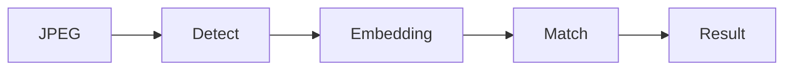

# Server

Face **Recognition** as an HTTP API (or .NET bindings) on **your** machine. Still-image detect, quality, template extract, 1:1 match, and template similarity. There is **no** server-side 1:N gallery (`POST /api/identify` does not exist).

Typical call order: `GET /api/machinecode` → send machine code → `POST /api/activate` → `POST /api/detect` / `match` / `similarity`. Default port **8083**.

For recognition **and** liveness in one process, see [Recognition + Liveness](../../recognition-and-liveness/). For on-device apps, use [Mobile SDK](../../recognition-and-liveness/mobile-sdk/). Open-source Python samples: [Open Source](../open-source-windows-and-linux/).

<table data-view="cards"><thead><tr><th></th><th></th><th></th><th data-hidden data-card-cover data-type="files"></th><th data-hidden data-card-target data-type="content-ref"></th></tr></thead><tbody><tr><td></td><td><strong>Linux SDK</strong></td><td>Docker Hub image faceplugin/face-recognition. Same HTTP API as Windows.</td><td><a href="../../../../.gitbook/assets/linux-docker.png">linux-docker.png</a></td><td><a href="face-recognition-linux-sdk.md">face-recognition-linux-sdk.md</a></td></tr><tr><td></td><td><strong>Windows SDK</strong></td><td>Commercial HTTP API on port 8083. CPU only. No Docker.</td><td><a href="../../../../.gitbook/assets/windows.png">windows.png</a></td><td><a href="face-recognition-windows-sdk.md">face-recognition-windows-sdk.md</a></td></tr><tr><td></td><td><strong>.NET SDK</strong></td><td>.NET MAUI and C# bindings. Follow the public GitHub README.</td><td><a href="../../../../.gitbook/assets/dotnet.png">dotnet.png</a></td><td><a href="../../recognition-and-liveness/recognition-and-liveness-server/face-recognition-dot-net-sdk.md">face-recognition-dot-net-sdk.md</a></td></tr></tbody></table>

### Frequently Asked Questions

**Is this a face recognition API?**

Yes. The server exposes an HTTP face recognition API on port 8083, with detect, match and similarity endpoints.

**Does the server support 1:N face search?**

No. There is no `POST /api/identify` endpoint. Store face templates in your own database and compare them with `/api/similarity`.

**What is the difference between the Docker and Windows versions?**

They expose the same API routes. The Linux version runs from the `faceplugin/face-recognition` Docker image; the Windows version runs natively without Docker.

**Does the face recognition server work offline?**

Yes. Once the license is activated, the server needs no internet connection.

**Can I run face recognition and liveness detection in one process?**

Yes. Use the Recognition + Liveness server, or run the Face Liveness server separately on port 8084.

### Related documentation

* [Capabilities](../../capabilities.md) · [Faceplugin Face Recognition Mobile SDK](../../recognition-and-liveness/mobile-sdk/) · [Face Recognition SDK](../../) · [Glossary](../../../../help/resources/glossary.md)
* [Face Liveness Detection Server SDK](../../liveness-detection-sdk/server-sdk/)
* [ID Document Recognition Server SDK](../../../id-document-recognition-sdk/recognition-and-liveness/server-sdk/)
* [Request a License](../../../../help/request-a-license-and-support.md) · [Status codes](../../../../help/resources/status-codes.md)
* [Combining products (eKYC)](../../../../getting-started/choose-a-product.md) · [SDK comparison](../../../../help/comparisons/)
