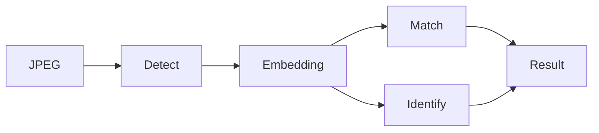

# Server

Face **Recognition** as an HTTP API on **your** machine: detect, quality, template extraction, 1:1 verification, 1:N identification against a local gallery, and template similarity. Python bindings ship beside the API for in-process use.

Typical call order: `GET /api/machinecode` → send the machine code → `POST /api/activate` → `POST /api/v1/detect` / `match` / `identify`. Default port **8092**, with the Gradio demo on **9092**.

Each product ships in two editions — **Lite** (the standard engine) and **Plus** (the premium engine for higher-accuracy deployments). On Docker they are the `latest` and `latest-plus` tags; on Windows they are two archives on the release page.

For on-device apps, use [Mobile SDK](../../recognition-and-liveness/mobile-sdk/). Open-source Python samples: [Open Source](../open-source-windows-and-linux/).

<table data-view="cards"><thead><tr><th></th><th></th><th></th><th data-hidden data-card-cover data-type="files"></th><th data-hidden data-card-target data-type="content-ref"></th></tr></thead><tbody><tr><td></td><td><strong>Docker SDK</strong></td><td>Docker Hub image faceplugin/face-recognition, tags latest and latest-plus. Also runs natively on Linux.</td><td><a href="../../../../.gitbook/assets/linux-docker.png">linux-docker.png</a></td><td><a href="face-recognition-linux-sdk.md">face-recognition-linux-sdk.md</a></td></tr><tr><td></td><td><strong>Windows SDK</strong></td><td>Commercial HTTP API on port 8092. CPU only. No Docker.</td><td><a href="../../../../.gitbook/assets/windows.png">windows.png</a></td><td><a href="face-recognition-windows-sdk.md">face-recognition-windows-sdk.md</a></td></tr></tbody></table>

### Frequently Asked Questions

**Is this a face recognition API?**

Yes. The server exposes an HTTP face recognition API on port 8092, with detect, quality, template, 1:1 match, similarity and 1:N identify endpoints.

**Does the server support 1:N face search?**

Yes. Enroll people through `/api/v1/persons`, then call `POST /api/v1/identify`. You can also keep templates in your own database and compare them with `/api/v1/similarity`.

**What is the difference between the Docker and Windows versions?**

They expose the same API routes. Docker runs from the `faceplugin/face-recognition` image; Windows runs natively without Docker.

**What is the difference between Lite and Plus?**

The engine. Lite is the standard recognition engine, Plus is the premium engine for higher-accuracy deployments. The API and the file layout are the same.

**Does the face recognition server work offline?**

Yes. Once the license is activated, the server needs no internet connection.

**Can I run face recognition and liveness detection in one process?**

Not as one product. Run [Face Liveness Detection](../../liveness-detection-sdk/server-sdk/) as a second service, or use the mobile [Recognition + Liveness](../../recognition-and-liveness/mobile-sdk/) SDK, which does both on the device.

### Related documentation

* [Capabilities](../../capabilities.md) · [Faceplugin Face Recognition Mobile SDK](../../recognition-and-liveness/mobile-sdk/) · [Face Recognition SDK](../../) · [Glossary](../../../../help/resources/glossary.md)
* [Face Liveness Detection Server SDK](../../liveness-detection-sdk/server-sdk/)
* [ID Document Recognition Server SDK](../../../id-document-recognition-sdk/recognition-and-liveness/server-sdk/)
* [Request a License](../../../../help/request-a-license-and-support.md) · [Status codes](../../../../help/resources/status-codes.md)
* [Combining products (eKYC)](../../../../getting-started/choose-a-product.md) · [SDK comparison](../../../../help/comparisons/)
