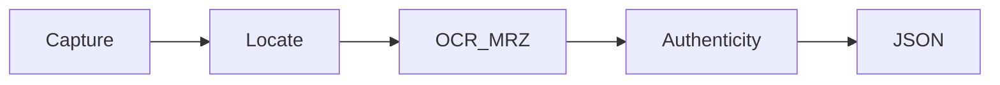

# Mobile

Capture and read identity documents on the device. Camera locate overlay (corners only — no OCR on every frame), then `recognize` / `documentProcess` for OCR, MRZ, barcode, image quality, and optional authenticity.

Every platform returns the same field set: [Document result JSON](../../document-result-json.md). Authenticity names: [Document security check fields](../../document-security-check-fields.md).

For HTTP APIs on Windows, Linux, and Docker, use [Server SDK](../server-sdk/). Prefer [Ionic Capacitor](id-document-recognition-ionic-capacitor-sdk.md) over Cordova for new Ionic apps.

<table data-view="cards"><thead><tr><th></th><th></th><th></th><th data-hidden data-card-cover data-type="files"></th><th data-hidden data-card-target data-type="content-ref"></th></tr></thead><tbody><tr><td></td><td><strong>Android SDK</strong></td><td>Native AAR. Camera, Gallery, and Result screens.</td><td><a href="../../../../.gitbook/assets/android.png">android.png</a></td><td><a href="id-document-recognition-android-sdk.md">id-document-recognition-android-sdk.md</a></td></tr><tr><td></td><td><strong>iOS SDK</strong></td><td>docsdk.framework. Same Camera and Gallery flow as Android.</td><td><a href="../../../../.gitbook/assets/apple-logo-3-300x300.png">apple-logo-3-300x300.png</a></td><td><a href="id-document-recognition-ios-sdk.md">id-document-recognition-ios-sdk.md</a></td></tr><tr><td></td><td><strong>Flutter SDK</strong></td><td>document_reader_sdk plugin plus an example app.</td><td><a href="../../../../.gitbook/assets/flutter.png">flutter.png</a></td><td><a href="id-document-recognition-flutter-sdk.md">id-document-recognition-flutter-sdk.md</a></td></tr><tr><td></td><td><strong>React Native SDK</strong></td><td>document-reader-sdk plugin. Yarn 3, not Expo Go.</td><td><a href="../../../../.gitbook/assets/react.png">react.png</a></td><td><a href="id-document-recognition-react-native-sdk.md">id-document-recognition-react-native-sdk.md</a></td></tr><tr><td></td><td><strong>Ionic Capacitor SDK</strong></td><td>document-reader-capacitor for new Ionic apps.</td><td><a href="../../../../.gitbook/assets/ionic.png">ionic.png</a></td><td><a href="id-document-recognition-ionic-capacitor-sdk.md">id-document-recognition-ionic-capacitor-sdk.md</a></td></tr><tr><td></td><td><strong>Ionic Cordova SDK</strong></td><td>Legacy Cordova plugin. Prefer Capacitor for new projects.</td><td><a href="../../../../.gitbook/assets/cordova.png">cordova.png</a></td><td><a href="id-document-recognition-ionic-cordova-sdk.md">id-document-recognition-ionic-cordova-sdk.md</a></td></tr></tbody></table>

### FAQ

**Does this do passport OCR on the phone?**

Yes. `recognize` / `documentProcess` return OCR, MRZ, barcode, and crops. See [Document result JSON](../../document-result-json.md).

**Is authenticity included?**

Only with a Liveness-capable license. Otherwise use [ID Document Liveness](../../id-document-liveness-sdk/).

### Related documentation

* [Capabilities](../../capabilities.md) · [Recognition + Liveness](../) · [Server SDK](../server-sdk/) · [ID Document SDK](../../) · [Glossary](../../../../help/resources/glossary.md)
* [Face Recognition Mobile SDK](../../../face-recognition-sdk/recognition-and-liveness/mobile-sdk/)
* [Document result JSON](../../document-result-json.md)
* [Request a License](../../../../help/request-a-license-and-support.md) · [Status codes](../../../../help/resources/status-codes.md)
* [Combining products (eKYC)](../../../../getting-started/choose-a-product.md) · [SDK comparison](../../../../help/comparisons/)
